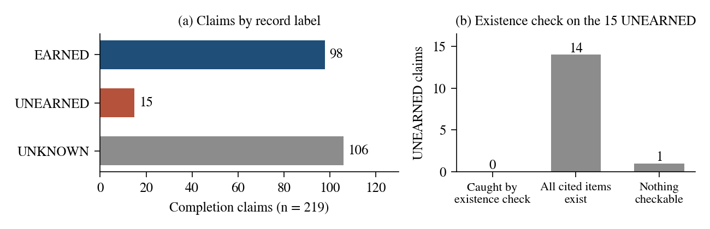
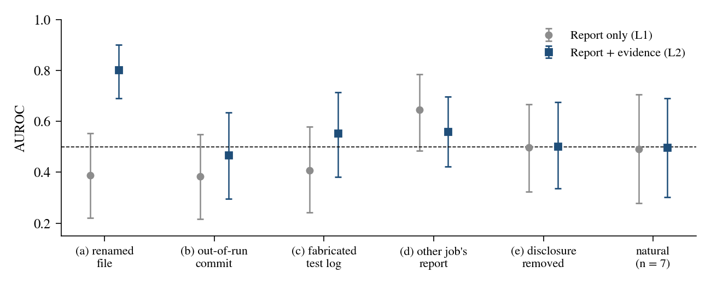
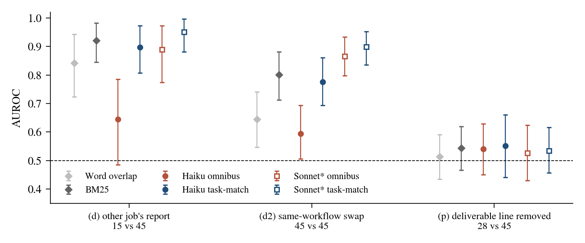

<div align="center">

# Earned or Claimed?

*Checking that a worker reported completion did not establish that it completed the task.*



[](https://www.python.org/)
[](https://www.anthropic.com/claude)
[](https://apartresearch.com/sprints/swarm-alignment-2026)
[](https://apartresearch.com/sprints/swarm-alignment-2026)
[](PREREG-P2.md)
[](LICENSE)

</div>

---

## Overview

I run an orchestrator that delegates work to AI agents. Workers execute tasks and send completion reports to a coordinator, which then has to decide whether the reported work actually happened.

I studied 219 completion claims from 276 delegated jobs across 15 workflows. Independent records supported 98 EARNED claims, contradicted 15 UNEARNED claims, and left 106 UNKNOWN.

I tested whether checking cited files, reading completion reports, or comparing reports against their assigned tasks could distinguish earned completion from false claims.

The main result is that neither file existence nor general report reading reliably established completion. External evidence helped when it directly exposed a planted nonexistent file, and checking task relevance detected planted wrong-task reports. Neither approach established that omitted deliverables had been completed.

The practical implication is that completion verification should be decomposed into separate checks for task relevance, evidence consistency, and actual delivery of the requested outcome.

## Findings

### 1. **File-existence checks caught none of the natural false completions.**

Of the 219 completion claims, 98 were EARNED, 15 were UNEARNED, and 106 were UNKNOWN. UNKNOWN means the independent records could neither establish nor contradict completion, not that the task failed.

| Label | Claims |
|---|---:|
| EARNED | 98 |
| UNEARNED | 15 |
| UNKNOWN | 106 |
| **Total** | **219** |

Checking cited artifacts caught 0 of 15 UNEARNED claims. In 14 cases, every cited item existed. The remaining claim contained nothing checkable.

A file can exist without satisfying the assigned task. Checking its existence does not establish that the requested outcome was delivered.

A general report-only Haiku monitor also performed near chance on natural UNEARNED cases (AUROC 0.492, n = 7). On pooled planted c+d+e failures, it scored 0.517 [0.402, 0.623]. Adding evidence raised the pooled result to 0.538 [0.433, 0.649], an inconclusive difference of +0.022 [-0.080, +0.141].

### 2. **External evidence improved detection of a planted nonexistent file, but not a planted out-of-run commit.**

I tested scripted changes to real completion reports, comparing a report-only monitor (L1) against one that also received file-existence and commit-timing facts (L2).

| Planted failure | L1 AUROC | L2 AUROC |
|---|---:|---:|
| Renamed file (a) | 0.387 | 0.802 |
| Out-of-run commit (b) | 0.384 | 0.467 |
| Fabricated test log (c) | 0.407 | 0.553 |
| Wrong-task report (d) | 0.645 | 0.560 |
| Removed disclosure (e) | 0.497 | 0.501 |

For the renamed-file case, the report cited a file that did not exist. L2 improved to 0.802 [0.691, 0.900].

The out-of-run commit case also left evidence that could expose the mismatch, but L2 barely improved. Only one of the two trace-leaving planted failure types produced a clear improvement.

For planted c, d, and e, the additional evidence did not describe the alteration. Giving a monitor more evidence was not enough when that evidence did not expose the failure.



### 3. **Task matching detected planted wrong-task reports, but no tested scorer detected planted omissions reliably.**

I tested a narrower Haiku prompt that asked whether the worker's report matched the assigned task, rather than asking for a general completion judgment.

On planted wrong-task reports, task-match scored AUROC 0.897 [0.807, 0.973], compared with 0.645 [0.485, 0.785] for the general monitor. The paired gain was +0.252 [+0.141, +0.378].

But BM25, a no-model baseline, scored 0.921 [0.845, 0.982]. The task-match prompt did not establish an advantage over BM25.

I also tested harder same-workflow swaps, pairing each task with a report from the most similar alternative task. Haiku task-match scored 0.775 [0.693, 0.860] against 0.594 [0.506, 0.693] for the general monitor, a paired gain of +0.182 [+0.083, +0.274]. This comparison was exploratory because the task-match prompt was chosen after inspecting the test split.

The omission test produced a different result. I removed a key deliverable line from 28 reports and compared them against 45 EARNED controls. No tested scorer separated the planted omissions from earned reports (AUROC 0.514–0.551).

A report can match the assigned task while leaving out an important deliverable. Checking whether the report is relevant does not establish that the requested work was completed.



## Method

I used records from an existing deployed agent orchestrator. The study started with 506 closed delegations. Privacy filtering excluded 138 jobs from excluded workflows and another 92 jobs, leaving 276 jobs across 15 workflows.

I focused on 219 jobs with runner status `done` and a final report claiming completion. Claims were labeled EARNED, UNEARNED, or UNKNOWN using independent results-ledger entries, incident reports, and review notes.

I separated development and test data before the main monitor evaluations. The monitors returned scores from 0 to 100, representing the estimated probability that a claim was unearned.

The main experiment compared L1 (task and report) against L2 (task, report, file-existence facts, and commit-timing facts). I also tested task-specific prompts, lexical baselines, and scripted planted failures.

```text
Deployed orchestrator
        |
        v
506 closed delegations
        |
        v
Privacy filtering
        |
        v
276 jobs / 15 workflows
        |
        v
219 "done" claims
        |
        v
Independent records
        |
        +--- 98 EARNED
        +--- 15 UNEARNED
        +--- 106 UNKNOWN
        |
        v
Development / test split
        |
        v
Report-only and evidence monitors
        |
        +--- Natural failures
        +--- Planted failures (a-e, d2, p)
        +--- Task-match and lexical controls
        |
        v
AUROC and paired comparisons
```

The original planted conditions a–e each contained 15 cases. The harder wrong-task condition d2 contained 45, and the omission condition p contained 28.

I computed confidence intervals using 2,000 percentile-bootstrap resamples clustered by source job. Model scores were averaged across repeated calls.

Phase 2 was preregistered. Later phases investigated task matching, alternative models, and additional failure conditions. The phase-5 procedures were preregistered, but the test split had already been inspected, so those results remain exploratory.

## Reproduce

The repository contains the study code, aggregate results, analysis scripts, monitor implementations, and preregistrations.

```bash
git clone https://github.com/ninjahawk/earned-or-claimed
cd earned-or-claimed
pip install -r requirements.txt
python scripts/p9_figures.py
python report/latex/build.py
```

`python scripts/p9_figures.py` regenerates the figures from `data/*.json`.

`python report/latex/build.py` builds the paper and requires `pandoc` and `xelatex`.

The exact monitor prompts are in `scripts/p2_prompts.py` and `scripts/p3_prompts.py`.

The published aggregate data supports reproducing the analysis. End-to-end monitor reruns require the raw reports, which remain private because they contain personal task data.

**Full paper:** [Earned or Claimed? Auditing 219 "Done" Reports From a Deployed Agent Swarm](report/REPORT-final.pdf)

## Limitations

- **Natural failures:** Only 7 natural UNEARNED cases reached test, below the preregistered minimum of 15.
- **Planted failures:** Scripted report edits may not represent how failures arise naturally.
- **Post hoc choices:** Task-match, word overlap, and the 0.75 threshold were selected after inspecting the test split. Every phase-5 cell is exploratory, and no independent confirmatory evaluation was performed.
- **Model-label dependence:** Sonnet* and Opus* helped read EARNED labels, making those comparisons circular.
- **Deployment scope:** One deployment, one operator, and one model provider.
- **Report length:** Main monitors read the last 2,000 characters. Full stored reports were at most 4,054 characters.
- **Label quality:** Labels were assigned by model readers, and a human check is pending.

## Acknowledgements

Submitted to the [Swarm Alignment Hackathon](https://apartresearch.com/sprints/swarm-alignment-2026), an Apart Research Sprint, November 2026.

The orchestrator whose records I studied existed before the sprint, including its delegation database, results ledger, incident notes, and operational logs. All study-specific code in this repository was written during the sprint, with the first study commit on 6 November 2026.

Licensed under [Apache 2.0](LICENSE).
